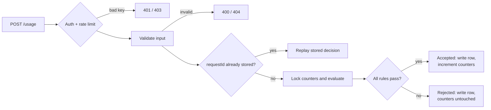

# Usage Metering & Quota Service

A backend service that answers one question for every API call: **may this request consume quota right now?** It meters usage for SaaS-style products that sell monthly allowances, enforces the rules atomically in PostgreSQL, and guarantees accepted usage is counted exactly once — even when clients retry or many requests race.

**The two quotas, in plain English:**

- **Company (account) quota** — the total units the whole account may consume in a calendar month: the company's subscription budget.
- **User quota** — every individual user inside the account has their own monthly allowance and per-request cap, so one heavy user cannot silently burn the company's budget.

Both limits matter together: the account quota bounds total spend, while user quotas provide fairness and blast-radius control inside the company. A usage request must pass **both** — either level failing rejects the request and consumes nothing.

> Portfolio project: demonstrates backend engineering practices with tests and measured evidence; see [Limitations](#limitations) for what has not been independently verified.

## Key Features

- **Account and user quotas evaluated as one decision.** `POST /usage` accepts only if the global per-request limit, both plans' per-request caps, the account's remaining allowance, and the user's remaining allowance all permit it. The response names exactly which rule bound: `account_quota_exceeded`, `user_quota_exceeded`, or `max_per_request_exceeded` with `limitScope` (`global` / `account` / `user`).
- **Configurable plans.** Four seeded system plans (Starter, Pro, Basic, Premium) are read-only for every tenant; each account manages its own custom plans via `POST` / `PATCH` / `DELETE /plans`. Assignments (`/assignments`) carry full history with effective dates, and a change applies immediately to the next request.
- **API-key authentication and account isolation.** Keys are `<prefix>.<secret>` with the secret stored as a SHA-256 hash; tenant identity is derived only from the key — client-supplied account IDs are never trusted. Composite foreign keys keep `(account_id, user_id)` pairs valid at the database level.
- **Full decision record.** Every request — accepted or rejected — is persisted with decision, reason, units, month, and resulting remainings. Rejected requests consume no quota but stay queryable as an audit trail.
- **Idempotent retries.** Resending the same `requestId` with the same payload replays the original committed response without consuming again; the same key with a different payload is `409 Conflict`.
- **Concurrency-safe accounting.** Counter rows are updated under row locks in a fixed order within one transaction; deadlock and serialization failures retry with backoff; PostgreSQL constraints re-enforce the same invariants if application logic is ever wrong.
- **Interactive company simulator.** The `simulate` command sets up a fictional tenant and provides a menu plus **12 guided scenarios** — quota accept/reject with `limitScope`, shared account pool, per-request caps, immediate plan changes, idempotent replay/conflict, validation and auth errors, usage history.
- **Operational surface.** `/health/live` and `/health/ready`, redacted structured logs, per-IP + per-key rate limiting (fail-closed), OpenAPI 3.1 with Swagger UI at `/docs`, and an invariant verifier (`npm run verify:invariants`) that cross-checks counters against the decision log.

## How It Works

A typical `POST /usage` request in five steps:

1. **Authenticate** — `Authorization: Bearer <key>` resolves the account; rate limits are checked per IP, then per API key.
2. **Validate** — Zod enforces `units` (string-encoded bigint, 1…`MAX_UNITS_PER_REQUEST`) and `requestId` (required, 1–255 chars); an unknown `userId` is `404`.
3. **Load context** — resolve the current plan assignments and this account's counters for the current **UTC month**. A known `requestId` short-circuits to a replay of its stored decision.
4. **Lock and evaluate** — take counter row locks in a fixed order and run the pure quota evaluator: per-request caps → account remaining → user remaining. **Both account-level and user-level rules must pass; the first failing rule becomes the rejection reason.**
5. **Persist and respond** — one transaction writes the decision row and, only if accepted, increments the counters, then returns `decision`, `accountRemaining`, optional `userRemaining`, and `periodStart`.



**Business rejection vs. HTTP error.** A quota rejection is a *successful* API call: **HTTP 200** with `"decision": "rejected"` and a `rejectionReason` — the correct client reaction is to stop, upgrade, or shed load, not to retry. HTTP errors mean no usage decision was reached: `400` validation, `401` bad key, `403` forbidden (e.g. modifying a system plan), `404` unknown user, `409` idempotency conflict or missing plan, `429` rate limit, `5xx` infrastructure. **Rejected requests never consume quota**, and they are still written to history.

## Architecture

Request flow with one dependency direction; PostgreSQL is the source of truth:

```text
Presentation   routes, Zod validation, auth, rate limiting   (Express)
     ↓
Application    use cases, transaction and lock boundaries     (usage, plans, assignments, keys)
     ↓
Domain         pure rules: quota evaluator, idempotency,     (no framework or DB imports)
               UTC month math
     ↓
Infrastructure Drizzle repositories, API-key verification,   (raw SQL where needed)
               rate-limiter store
     ↓
PostgreSQL 16  row locks, unique / CHECK / EXCLUDE constraints, forward-only migrations
```

- **Presentation** handles HTTP only: routing, input schemas, authenticated context, status mapping.
- **Application** owns workflows and the transaction boundaries where locks are taken.
- **Domain** is pure TypeScript — the quota evaluator operates on bigints, so quota rules are unit-tested without Express or a database.
- **Infrastructure** executes SQL; native `bigint` flows end to end and serializes to JSON as strings.

**Stack:** TypeScript (strict) · Node.js · Express · PostgreSQL 16 · Drizzle ORM · Zod · Pino · Vitest + Supertest · Docker Compose · OpenAPI 3.1.

Schema, invariants, and the concurrency matrix: [`docs/ARCHITECTURE.md`](docs/ARCHITECTURE.md). Endpoint contracts: [`docs/API.md`](docs/API.md).

## Quick Start

Prerequisites: Docker + Docker Compose.

```bash
# 1. Start app + PostgreSQL (migrations and bootstrap run automatically)
docker compose up -d --build

# 2. Fetch the bootstrap API key (generated on first start, kept in a Docker volume)
export API_KEY=$(docker compose exec -T app cat /run/secrets/api-key)

# 3. Sanity check
curl -s http://localhost:3000/health/ready
# {"status":"ok","checks":{"database":{"healthy":true,...}}}
```

On the very first start the key is also printed to the logs (`docker compose logs app | grep "BOOTSTRAP API KEY"`). It is shown once; later restarts reuse the stored key.

Run the example client — a scripted walkthrough of the whole lifecycle:

```bash
docker compose run --rm client
# ...
# Scenario summary: 57/57 checks passed
# All demo assertions passed.
# All accounting invariants passed.
```

Launch the **interactive company simulator** (keep stdin attached for menu choices):

```bash
docker compose run -i --rm client node dist/cli/index.js simulate
```

Expected: a readiness check, idempotent setup of the fictional *Acme Corp* tenant (plans, users, assignments), then a numbered menu — dashboard, users & balances, consume, plans, assignments, paginated history — including `11) Guided scenarios (12)`. Every action is re-read from the service; `0` exits cleanly.

Without Docker: `npm install`, set `DATABASE_URL` in `.env` (see [`.env.example`](.env.example)), then `npm run db:migrate && npm run dev`.

## Example

Real contract shapes — exact remainings depend on your plans; full reference in [`docs/API.md`](docs/API.md).

```bash
curl -X POST http://localhost:3000/usage \
  -H "Authorization: Bearer $API_KEY" \
  -H "Content-Type: application/json" \
  -d '{"userId": "user123", "units": "5", "requestId": "req-001"}'
```

Accepted — HTTP 200:

```json
{
  "decision": "accepted",
  "accountRemaining": "995",
  "userRemaining": "495",
  "periodStart": "2026-10-01"
}
```

Rejected because the account budget is exhausted — also HTTP 200, zero quota consumed:

```json
{
  "decision": "rejected",
  "rejectionReason": "account_quota_exceeded",
  "accountRemaining": "0",
  "userRemaining": "495",
  "periodStart": "2026-10-01"
}
```

Sending the same `requestId` and payload again replays the identical committed response; changing the payload under that key returns `409 Conflict`. Remaining values are strings because they are PostgreSQL `bigint`s.

## Design Decisions

- **UTC calendar months, stamped at admission** — one unambiguous period for every replica, and the month is sampled after the account lock so a request queued across a boundary is charged to the month it is actually admitted in.
- **The decision log is the idempotency store** — `usage_requests` holds a unique `(account_id, idempotency_key)` plus a hash of `{accountId, userId, units}`: same key + same hash replays the stored result, same key + different hash is `409`, with no second table that could drift out of sync.
- **Row locks serialize consumption** — account and user counters are updated under locks held to commit in a fixed order (account → account counter → user counter → API key), trading per-account throughput for a hard no-overspend guarantee under concurrency.
- **Plan changes are immediate and never reset counters** — the next request uses the new plan; remaining = new allowance − usage already consumed this month, clamped at `0` when an allowance is lowered below consumption.
- **Rejections are recorded but free** — they get history rows for audit and idempotent replay while incrementing nothing.
- **Fail-closed missing plans** — a user-scoped request with no effective user plan is `409`, never a silent fallback to account-only accounting.
- **Database constraints back the application logic** — composite tenant FKs, `CHECK (counter >= 0)`, and assignment-overlap `EXCLUDE` constraints keep invariants even if application code has a bug.
- **Retries for transient transaction failures** — deadlock (`40P01`) and serialization (`40001`) failures retry up to 3× with exponential backoff, since explicit locking under contention can surface them.

## Testing and Performance

```bash
docker compose up -d postgres-test    # test database used by the suite
npm run verify                        # typecheck + lint + build + full test suite

docker compose run --rm app node dist/scripts/verify-invariants.js   # counters vs decision log
npm run loadtest -- --duration 30 --connections 10                   # autocannon baseline (needs LOADTEST_API_KEY)
```

- Tests run against **real PostgreSQL** — no database mocks: pure-domain unit tests, HTTP integration through the full Express pipeline, concurrency races, month boundaries, and direct-SQL constraint proofs. Latest verified run: **23 files, 234 tests, all passing**.
- **Measured local baseline** (2026-10-19, Compose stack on one WSL2 dev machine, 30 s × 10 connections, rate limit raised for the measurement window): **120.44 req/s**, p50 79 ms, p90 96 ms, p99 146 ms, **0 errors / 0 timeouts / 0 non-2xx**; after the run the counter matched accepted usage exactly (+3,623) and all database invariants held. This is a single-machine baseline for that environment — **not** a production capacity claim. Method and reproduction: [`docs/performance/2026-10-19-baseline.md`](docs/performance/2026-10-19-baseline.md). Deeper soak and boundary-race campaign: [`docs/performance/README.md`](docs/performance/README.md).

## Limitations

- **Rate limiting is per process** — counters live in a bounded in-process store: they reset on restart and are not shared between replicas; multi-replica deployments need their own shared store.
- **A single hot account is serialized** — the no-overspend design caps one account at ~120 req/s (measured); scaling one tenant further requires counter sharding, deliberately out of scope.
- **`usage_requests` grows without bound** — no retention or archival job for idempotency keys and history yet.
- **No distributed tracing or metrics** — structured logs with request IDs only.
- **Not independently audited** — security controls are implemented and tested but unreviewed by a third party; `drizzle-orm` 0.33 carries advisory GHSA-gpj5-g38j-94v9 (identifier escaping — a pattern this codebase does not use), with the upgrade to 0.45.x scheduled as maintenance.
