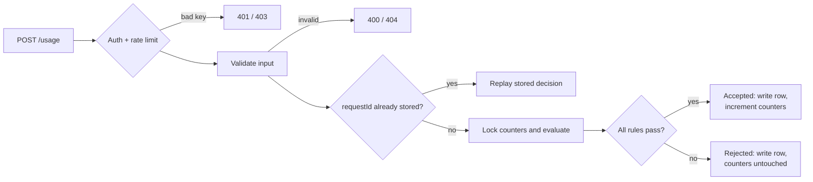

# Usage Metering & Quota Service

A backend service that answers one question for every API call: **may this request consume quota right now?** It meters usage for SaaS-style products that sell monthly allowances, enforces the rules atomically in PostgreSQL, and guarantees accepted usage is counted exactly once — even when clients retry or many requests race.

**The two quotas, in plain English:**

- **Company (account) quota** — the total units the whole account may consume in a calendar month: the company's subscription budget.
- **User quota** — every individual user inside the account has their own monthly allowance and per-request cap, so one heavy user cannot silently burn the company's budget.

Both limits matter together: the account quota bounds total spend, while user quotas provide fairness and blast-radius control inside the company. A usage request must pass **both** — either level failing rejects the request and consumes nothing.

> Portfolio project: demonstrates backend engineering practices with tests and measured evidence; see [Limitations](#limitations) for what has not been independently verified.

## Quick Start

Prerequisites: Docker + Docker Compose.

```bash
# 1. Start app + PostgreSQL (migrations and bootstrap run automatically)
docker compose up -d --build

# 2. Fetch the bootstrap API key (generated on first start, kept in a Docker volume)
export API_KEY=$(docker compose exec -T app cat /run/secrets/api-key)

# 3. Sanity check
curl -s http://localhost:3000/health/ready
# {"status":"ok","checks":{"database":{"healthy":true,...}}}
```

On the very first start the key is also printed to the logs (`docker compose logs app | grep "BOOTSTRAP API KEY"`). It is shown once; later restarts reuse the stored key.

Run the example client — a scripted walkthrough of the whole lifecycle:

```bash
docker compose run --rm client
# ...
# Scenario summary: 57/57 checks passed
# All demo assertions passed.
# All accounting invariants passed.
```

Launch the **interactive company simulator** (keep stdin attached for menu choices):

```bash
docker compose run -i --rm client node dist/cli/index.js simulate
```

Expected: a readiness check, idempotent setup of the fictional *Acme Corp* tenant (plans, users, assignments), then a numbered menu — dashboard, users & balances, consume, plans, assignments, paginated history — including `11) Guided scenarios (12)`. Every action is re-read from the service; `0` exits cleanly.

Without Docker: `npm install`, set `DATABASE_URL` in `.env` (see [`.env.example`](.env.example)), then `npm run db:migrate && npm run dev`.

## Key Features

- **Account and user quotas evaluated as one decision.** `POST /usage` accepts only if the global per-request limit, both plans' per-request caps, the account's remaining allowance, and the user's remaining allowance all permit it. The response names exactly which rule bound: `account_quota_exceeded`, `user_quota_exceeded`, or `max_per_request_exceeded` with `limitScope` (`global` / `account` / `user`).
- **Configurable plans.** Four seeded system plans (Starter, Pro, Basic, Premium — values below) are read-only for every tenant; each account manages its own custom plans via `POST` / `PATCH` / `DELETE /plans`. Assignments (`/assignments`) carry full history with effective dates, and a change applies immediately to the next request.
- **API-key authentication and account isolation.** Keys are `<prefix>.<secret>` with the secret stored as a SHA-256 hash; tenant identity is derived only from the key — client-supplied account IDs are never trusted. Composite foreign keys keep `(account_id, user_id)` pairs valid at the database level.
- **Full decision record.** Every request — accepted or rejected — is persisted with decision, reason, units, month, and resulting remainings. Rejected requests consume no quota but stay queryable as an audit trail.
- **Idempotent retries.** Resending the same `requestId` with the same payload replays the original committed response without consuming again; the same key with a different payload is `409 Conflict`.
- **Concurrency-safe accounting.** Counter rows are updated under row locks in a fixed order within one transaction; deadlock and serialization failures retry with backoff; PostgreSQL constraints re-enforce the same invariants if application logic is ever wrong.
- **Interactive company simulator.** The `simulate` command sets up a fictional tenant and provides a menu plus **12 guided scenarios** — quota accept/reject with `limitScope`, shared account pool, per-request caps, immediate plan changes, idempotent replay/conflict, validation and auth errors, usage history.
- **Operational surface.** `/health/live` and `/health/ready`, redacted structured logs, per-IP + per-key rate limiting (fail-closed), OpenAPI 3.1 with Swagger UI at `/docs`, and an invariant verifier (`npm run verify:invariants`) that cross-checks counters against the decision log.

## How It Works

A typical `POST /usage` request in five steps:

1. **Authenticate** — `Authorization: Bearer <key>` resolves the account; rate limits are checked per IP, then per API key.
2. **Validate** — Zod enforces `units` (string-encoded bigint, 1…`MAX_UNITS_PER_REQUEST`) and `requestId` (required, 1–255 chars); an unknown `userId` is `404`.
3. **Load context** — resolve the current plan assignments and this account's counters for the current **UTC month**. A known `requestId` short-circuits to a replay of its stored decision.
4. **Lock and evaluate** — take counter row locks in a fixed order and run the pure quota evaluator: per-request caps → account remaining → user remaining. **Both account-level and user-level rules must pass; the first failing rule becomes the rejection reason.**
5. **Persist and respond** — one transaction writes the decision row and, only if accepted, increments the counters, then returns `decision`, `accountRemaining`, optional `userRemaining`, and `periodStart`.



**Business rejection vs. HTTP error.** A quota rejection is a *successful* API call: **HTTP 200** with `"decision": "rejected"` and a `rejectionReason` — the correct client reaction is to stop, upgrade, or shed load, not to retry. HTTP errors mean no usage decision was reached: `400` validation, `401` bad key, `403` forbidden (e.g. modifying a system plan), `404` unknown user, `409` idempotency conflict or missing plan, `429` rate limit, `5xx` infrastructure. **Rejected requests never consume quota**, and they are still written to history.

## Account vs. User Quota — A Worked Example

Captured from a real fresh stack (`app-test` profile, port 3001 — disposable, so the numbers below are exactly reproducible):

```bash
docker compose --profile app-test up -d --wait app-test
KEY=$(docker exec usage-metering-app-test cat /run/secrets/api-key)
B=http://localhost:3001; AUTH="Authorization: Bearer $KEY"
J='Content-Type: application/json'

# Two users
curl -s -X POST $B/users -H "$AUTH" -H "$J" -d '{"clientUserId":"alice"}'
curl -s -X POST $B/users -H "$AUTH" -H "$J" -d '{"clientUserId":"bob"}'

# Small custom account plan: 100 units shared per month, 50 max per request
curl -s -X POST $B/plans -H "$AUTH" -H "$J" \
  -d '{"name":"Sandbox","type":"account","monthlyAllowance":"100","maxUnitsPerRequest":"50"}'
# -> {"id":5,...}

# Account moves from the default Starter plan to Sandbox (immediate);
# predefined user plans: Basic (id 3) -> alice, Premium (id 4) -> bob
curl -s -X POST $B/assignments -H "$AUTH" -H "$J" -d '{"planId":5}'
curl -s -X POST $B/assignments -H "$AUTH" -H "$J" -d '{"planId":3,"userId":"alice"}'
curl -s -X POST $B/assignments -H "$AUTH" -H "$J" -d '{"planId":4,"userId":"bob"}'
```

Five usage requests, every one **HTTP 200**:

| # | Request | Decision | `accountRemaining` (Sandbox: 100) | `userRemaining` | Reason |
|---|---------|----------|-----------------------------------|-----------------|--------|
| 1 | bob, 40 units | accepted | 60 | 4960 (bob, Premium 5000) | — |
| 2 | alice, 40 units | rejected | 60 | 500 (alice, Basic) | `max_per_request_exceeded`, `limitScope=user` (Basic caps 20/request) |
| 3 | bob, 40 units | accepted | 20 | 4920 | — |
| 4 | alice, 20 units | accepted | 0 | 480 | — |
| 5 | alice, 1 unit | rejected | 0 | 480 | `account_quota_exceeded` |

Accepted (request 1):

```json
{
  "decision": "accepted",
  "accountRemaining": "60",
  "userRemaining": "4960",
  "periodStart": "2026-10-01"
}
```

Rejected because the shared budget is gone (request 5) — still HTTP 200, zero quota consumed:

```json
{
  "decision": "rejected",
  "rejectionReason": "account_quota_exceeded",
  "accountRemaining": "0",
  "userRemaining": "480",
  "periodStart": "2026-10-01"
}
```

**What this shows:**

- **A larger user plan never enlarges the shared account budget.** Bob's Premium plan holds 4,920 units after request 3, yet request 3 left the account with only 20 — the account's Sandbox allowance is the ceiling for everyone. Request 5 is the proof at the other end: alice still has 480 personal units, but the company pool is empty, so the request is refused and nothing is consumed.
- **User rules bind independently.** Request 2 was refused by alice's own per-request cap (20) while her allowance and the account budget were untouched.
- **Rejections are data, not errors.** All five responses are HTTP 200; the rejected two are persisted in history with their reason and remainings, and a replay of their `requestId` returns the same stored decision.

```bash
docker compose --profile app-test rm -sf app-test postgres-app-test   # discard the scratch stack
```

## Plans

Predefined system plans, seeded once at bootstrap (values in plain units per UTC calendar month):

| Plan | Type | Monthly allowance | Max units / request | Owner |
|------|------|-------------------|---------------------|-------|
| Starter | account | 10,000 | 100 | system (read-only) |
| Pro | account | 1,000,000 | 1,000 | system (read-only) |
| Basic | user | 500 | 20 | system (read-only) |
| Premium | user | 5,000 | 200 | system (read-only) |

- **A fresh account starts on Starter** (10,000 units/month, 100 max/request) until an assignment says otherwise.
- System plans form one shared catalog: every tenant can assign them, none can modify or delete them (`403` on system-plan writes).
- Custom plans (`POST /plans`) belong to one account and are freely changed or deactivated there; **plan changes apply to the very next request** and never reset counters.
- Assignments (`POST /assignments`, account- or user-scoped) are immediate by default, carry optional `effectiveFrom`, and keep full history; overlapping current assignments are rejected by a database `EXCLUDE` constraint.

## Architecture

Request flow with one dependency direction; PostgreSQL is the source of truth:

```text
Presentation   routes, Zod validation, auth, rate limiting   (Express)
     ↓
Application    use cases, transaction and lock boundaries     (usage, plans, assignments, keys)
     ↓
Domain         pure rules: quota evaluator, idempotency,     (no framework or DB imports)
               UTC month math
     ↓
Infrastructure Drizzle repositories, API-key verification,   (raw SQL where needed)
               rate-limiter store
     ↓
PostgreSQL 16  row locks, unique / CHECK / EXCLUDE constraints, forward-only migrations
```

- **Presentation** handles HTTP only: routing, input schemas, authenticated context, status mapping.
- **Application** owns workflows and the transaction boundaries where locks are taken.
- **Domain** is pure TypeScript — the quota evaluator operates on bigints, so quota rules are unit-tested without Express or a database.
- **Infrastructure** executes SQL; native `bigint` flows end to end and serializes to JSON as strings.

**Stack:** TypeScript (strict) · Node.js · Express · PostgreSQL 16 · Drizzle ORM · Zod · Pino · Vitest + Supertest · Docker Compose · OpenAPI 3.1.

Schema, invariants, and the concurrency matrix: [`docs/ARCHITECTURE.md`](docs/ARCHITECTURE.md). Endpoint contracts: [`docs/API.md`](docs/API.md).

## Assumptions and Scope

What the service assumes, and what callers may rely on:

- **Accounts are provisioned by the operator only.** There is no public account-signup endpoint: an operator script (`npm run bootstrap`, run inside the stack) creates the account and its first API key. Tenant identity always derives from the authenticated key — a client-supplied account id is never trusted.
- **`units` is a generic resource counter.** API calls, tokens, bytes, credits — the service counts integers and enforces limits; the caller defines what one unit means.
- **Quota rejections are HTTP 200** with `decision: "rejected"`; HTTP status errors mean no usage decision was reached (400/401/403/404/409/429/5xx). Clients must branch on `decision`, not on status alone.
- **Months are UTC calendar months**, stamped once per request at admission; counters, history, and remainings are all scoped to that period (`periodStart`).
- **Plan changes are immediate and non-destructive** — the next request uses the new plan, counters are never reset, and lowering an allowance below this month's usage clamps remaining to `0`.
- **Rejected requests are recorded and consume nothing.** They are queryable audit rows and participate in idempotent replay without ever moving a counter.
- **A user-scoped request with no effective user plan fails closed** (`409`), never silently falling back to account-only accounting.
- **Idempotency keys are unique per account** (`requestId`, 1–255 chars): same key + identical payload replays the stored decision; same key + changed payload is `409 Conflict`.
- **API keys are shown once.** Creation returns the full `<prefix>.<secret>` exactly once; only the prefix and a SHA-256 hash are stored afterwards.

## Design Decisions

- **UTC calendar months, stamped at admission** — one unambiguous period for every replica, and the month is sampled after the account lock so a request queued across a boundary is charged to the month it is actually admitted in.
- **The decision log is the idempotency store** — `usage_requests` holds a unique `(account_id, idempotency_key)` plus a hash of `{accountId, userId, units}`: same key + same hash replays the stored result, same key + different hash is `409`, with no second table that could drift out of sync.
- **Row locks serialize consumption** — account and user counters are updated under locks held to commit in a fixed order (account → account counter → user counter → API key), trading per-account throughput for a hard no-overspend guarantee under concurrency.
- **Plan changes are immediate and never reset counters** — the next request uses the new plan; remaining = new allowance − usage already consumed this month, clamped at `0` when an allowance is lowered below consumption.
- **Rejections are recorded but free** — they get history rows for audit and idempotent replay while incrementing nothing.
- **Fail-closed missing plans** — a user-scoped request with no effective user plan is `409`, never a silent fallback to account-only accounting.
- **Database constraints back the application logic** — composite tenant FKs, `CHECK (counter >= 0)`, and assignment-overlap `EXCLUDE` constraints keep invariants even if application code has a bug.
- **Retries for transient transaction failures** — deadlock (`40P01`) and serialization (`40001`) failures retry up to 3× with exponential backoff, since explicit locking under contention can surface them.

## Testing and Performance

```bash
docker compose up -d postgres-test    # test database used by the suite
npm run verify                        # typecheck + lint + build + full test suite

# Counter accounting vs the decision log (INV-1…INV-8, whole database):
docker compose run --rm app node dist/scripts/verify-invariants.js

# Load-test modes (bootstrap the load-test account first, see docs/performance/):
npm run loadtest -- --duration 30 --connections 10            # baseline shape
npm run loadtest -- --users 10 --duration 30                  # many users sharing one account counter
npm run loadtest -- --duplicate-every 5 --duration 30         # idempotent replays under load
npm run loadtest -- --near-quota --headroom 50 --duration 30  # sustained rejections at the limit
```

- Tests run against **real PostgreSQL** — no database mocks: pure-domain unit tests, HTTP integration through the full Express pipeline, concurrency races, month boundaries, plan-change effects, hot-path equivalence, and direct-SQL constraint proofs. Latest verified run: **25 files, 244 tests, all passing**.

### Benchmark: baseline vs. optimized request path

Same workload, same machine, same stack — only the request-path optimization in between. Three warm 30 s runs each, no cherry-picking:

| Metric | Baseline | After optimization |
|--------|---------:|-------------------:|
| Throughput (mean of 3 runs) | 118.2 req/s (112.6 / 121.0 / 121.1) | **125.6 req/s (124.3 / 128.6 / 123.7)** |
| Latency p50 (per-run) | 85 / 80 / 80 ms | 77 / 75 / 76 ms |
| Latency p90 (per-run) | 97 / 88 / 88 ms | 90 / 84 / 86 ms |
| Latency p99 (per-run) | 175 / 141 / 116 ms | 124 / 110 / 166 ms |
| Errors / timeouts / non-2xx | 0 / 0 / 0 | 0 / 0 / 0 |
| Accepted / rejected (measured runs) | 10,641 / 0 | 11,299 / 0 |

**Workload:** account-scoped `POST /usage`, `units=1`, unique idempotency key per request, pipelining 1, 10 connections, 5 s warm-up discarded, `RATE_LIMIT_MAX` raised only for the window and restored afterwards, Docker Compose stack on one 12-core WSL2 dev machine. Before/after accepted deltas matched the account counter exactly and `verify-invariants.js` (INV-1…INV-8) passed after every run.

**What changed (two small edits, same correctness model):**

1. **Fused assignment + plan resolution** — the usage hot path resolved the current assignment and then loaded its plan as two queries per scope; it is now one join per scope with identical predicates and filters (including fail-closed 409 when the assigned plan is unusable). A user-scoped transaction drops from 14 to 12 statements, each removed statement saving a round trip *and* a parse/plan inside the serialized section.
2. **Throttled API-key last-used stamp** — the advisory `last_used_at` telemetry column is now written at most once per 10 s per key (first use always stamps), skipping a tuple write + WAL record per request on the hot path.

**How to read it:** the optimized runs (124–129 req/s) sit above every baseline run (113–121); p50 improved 80–85 → 75–77 ms with no tail regression beyond run-to-run noise. The remaining plateau is connection-latency-bound on purpose: every accepted request still holds the account's counter row lock through a durable commit, which is the no-overspend design — two accounts in parallel were measured at 162 req/s combined, so the lock is per account, not global. Options measured and rejected: `synchronous_commit=off` (durability), folding the admission clock into the lock statement (documented correctness risk), multi-row counter increment (weakens fixed lock order). Full evidence: [`docs/performance/2026-10-20-request-path-optimization.md`](docs/performance/2026-10-20-request-path-optimization.md); workload/bottleneck analysis: [`docs/performance/2026-10-20-loadtest-workloads.md`](docs/performance/2026-10-20-loadtest-workloads.md); initial single-run baseline: [`docs/performance/2026-10-19-baseline.md`](docs/performance/2026-10-19-baseline.md). Single-machine measurements, **not** a production capacity claim.

## Limitations

- **Rate limiting is per process** — counters live in a bounded in-process store: they reset on restart and are not shared between replicas; multi-replica deployments need their own shared store.
- **A single hot account is serialized** — the no-overspend design caps one account at the measured ~120–130 req/s on this machine after the request-path optimization; scaling one tenant further requires counter sharding, deliberately out of scope.
- **`usage_requests` grows without bound** — no retention or archival job for idempotency keys and history yet.
- **No distributed tracing or metrics** — structured logs with request IDs only.
- **Not independently audited** — security controls are implemented and tested but unreviewed by a third party; `drizzle-orm` 0.33 carries advisory GHSA-gpj5-g38j-94v9 (identifier escaping — a pattern this codebase does not use), with the upgrade to 0.45.x scheduled as maintenance.
